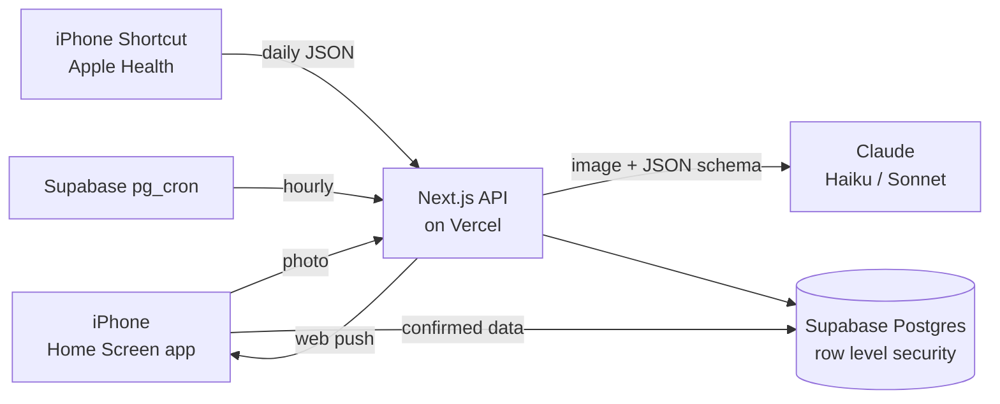

# Snapfit

**Snap a photo instead of typing.** Photograph your bathroom scale, your plate, or a Nike Run Club or Hevy workout summary. Snapfit reads the numbers, you check them, and it logs them. Sleep, resting heart rate and workouts arrive from Apple Health on their own. Once a week, a coach reads two weeks of your data and tells you the two or three changes that would help most.

Built to get back in shape together with my kid. It runs on free plans plus a few cents of AI a month.


## What it does

| | |
|---|---|
| **Scale** | Photo of the display → weight, with a 7-weigh-in average to smooth out daily swings |
| **Meal** | Photo of the plate → foods, calories, protein, carbs, fat, fiber, veg & fruit servings, and one tip |
| **Workout** | Nike Run Club or Hevy screenshot → distance, time, calories, volume lifted |
| **Sleep** | Sleep app screenshot, or automatic from Apple Health |
| **Check-in** | 10-second stress, energy and rest scores, morning and evening |
| **Water** | One-tap +250 / +500 ml, with push reminders only when you're behind |
| **Coach** | Two weeks of data → what's working, any link between sleep, stress and food, and what to change this week |
| **Family** | Separate profiles. Kid profiles track habits and never get calorie targets or diet advice. |

Every photo reading is reviewed before it's saved, and photos are never stored.

## Architecture



More detail, including the security model and delivery pipeline: [docs/ARCHITECTURE.md](docs/ARCHITECTURE.md).

## Tech stack

- **App:** Next.js 16 (App Router), React 19, TypeScript, Tailwind CSS 4, installable as a PWA
- **Data and auth:** Supabase Postgres with row level security, email one-time codes, `pg_cron` for scheduled jobs
- **AI:** Claude API with structured outputs (Zod schemas), per-call cost logging
- **Notifications:** Web Push (VAPID) through a service worker
- **Quality:** Vitest unit tests, ESLint, strict TypeScript
- **DevOps:** GitHub Actions CI on every pull request, Vercel preview deploys per PR, Dependabot, versioned database migrations

## Design decisions

Each one is written up as a short decision record:

1. [A web app, not a native app](docs/adr/0001-pwa-not-native.md): no $99/year Apple fee, with Apple Health bridged through a Shortcut
2. [Supabase + Vercel, scheduled jobs in Supabase](docs/adr/0002-supabase-and-vercel.md)
3. [One `entries` table with Zod-validated JSON](docs/adr/0003-one-entries-table.md)
4. [Photos are read, then thrown away](docs/adr/0004-photos-are-not-stored.md)
5. [Cheapest model per job, every call's cost logged](docs/adr/0005-claude-models-and-cost.md)

## Running costs

| Service | Plan | Monthly cost |
|---|---|---|
| Vercel | Hobby | $0 |
| Supabase | Free | $0 |
| GitHub + Actions | Free (public repo) | $0 |
| Claude API | Pay per use | ~$0.15 (all Haiku) to ~$3 (Sonnet for meals) |

## Get it running

Full walkthrough, from zero to the app on your iPhone: **[docs/SETUP.md](docs/SETUP.md)**. Apple Health sync: **[docs/SHORTCUT.md](docs/SHORTCUT.md)**.

Local development:

```bash
cp .env.example .env.local   # fill in your Supabase and Claude keys
npm install
npm run dev
```

Checks (the same ones CI runs):

```bash
npm run lint && npm run typecheck && npm test && npm run build
```

## Roadmap

- [x] Photo logging for scale, meals, workouts and sleep
- [x] Water tracking with smart push reminders
- [x] Stress, energy and rest check-ins
- [x] Apple Health import through an iPhone Shortcut
- [x] AI coach with kid-safe guardrails
- [ ] Weekly report pushed every Sunday
- [ ] Trends page: sleep vs. snacking, stress vs. workouts
- [ ] Hevy API sync for set-by-set detail (needs Hevy Pro)
- [ ] Progress photos in a private storage bucket (opt-in)
- [ ] End-to-end tests with Playwright against the Vercel preview

## Privacy

See [docs/PRIVACY.md](docs/PRIVACY.md). In short: no photos stored, every table locked to its owner by the database, and the kid profile never gets diet advice.

## License

MIT
