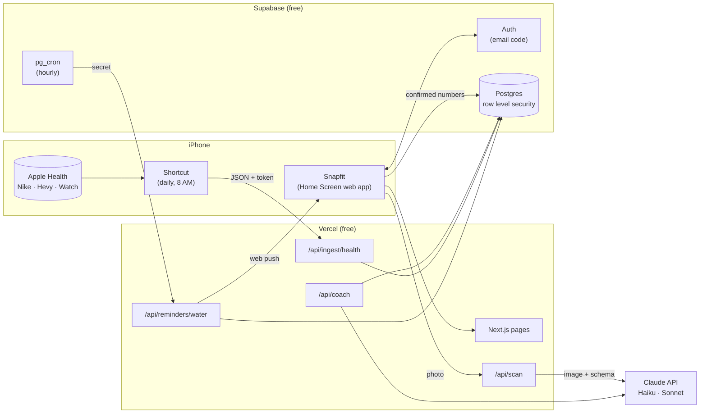
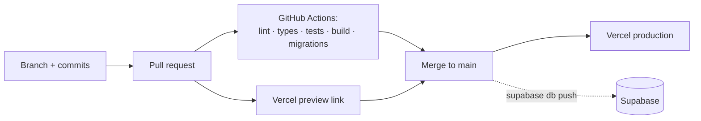

# Architecture

## The big picture

## How a photo becomes data

1. You tap **Meal** and take a photo. The phone shrinks it to 1024 px (`src/lib/image.ts`).
2. `/api/scan` checks you're signed in, sends the image and a prompt to Claude, and asks for JSON matching a Zod schema (`src/lib/scan.ts`).
3. The numbers come back to the phone as an editable form. Nothing is saved yet, and the photo is not stored.
4. You fix anything wrong and tap **Save**. The phone writes one row to `entries` directly through Supabase. Row level security makes sure it can only be your row, for one of your people.
5. Token use and cost go into `ai_usage`, so Settings can show the month's spend.

## Where code lives

| Path | What's there |
|---|---|
| `src/app/` | Pages (`/`, `/login`, `/settings`) and API routes (`/api/*`) |
| `src/components/` | Dashboard cards: snap buttons, water, check-in, chart, coach, log |
| `src/lib/` | Logic with no UI: entry schemas, scan prompts, stats, reminders, cost, Apple Health parsing |
| `src/lib/supabase/` | Three Supabase clients: browser, server (as the user), admin (service role, server only) |
| `src/proxy.ts` | Refreshes the sign-in cookie and sends signed-out visitors to `/login` |
| `supabase/migrations/` | Database schema and access rules, applied with `supabase db push` |
| `public/sw.js` | Service worker: shows push notifications |
| `tests/` | Unit tests for `src/lib` (Vitest) |
| `docs/adr/` | Why things are built the way they are |

## Delivery pipeline

Dependabot opens weekly pull requests for dependency updates, and the same checks run on them.

## Security model

- **Sign-in:** Supabase email codes. No passwords stored.
- **Data access:** every table has row level security, so a signed-in user can only read or write rows where `owner = auth.uid()`. This is enforced by Postgres, so a bug in app code can't leak another account's data.
- **Secrets:** the Claude key, Supabase service-role key, VAPID private key and cron secret exist only in Vercel's environment settings. The browser only ever gets the public Supabase key and the public VAPID key.
- **Service-role access** (which bypasses row level security) is used in exactly two places: the Apple Health import (after checking the personal token) and the hourly reminder job (after checking the cron secret). Both filter by owner explicitly.
- **Shortcut tokens** are stored only as SHA-256 hashes. Creating a new one replaces the old one.
